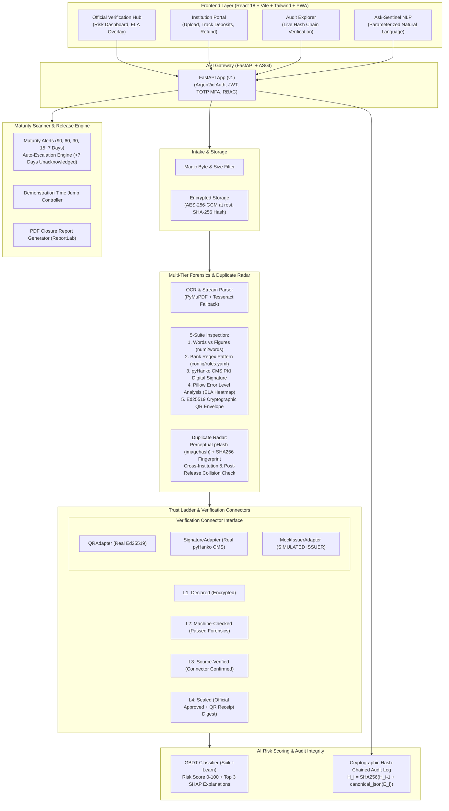

# FDR-Sentinel: Autonomous Security Deposit & Fixed Deposit Receipt Verification Portal

[](https://github.com/aicte/fdr-sentinel/actions/workflows/ci.yml)
[](LICENSE)
[](https://www.python.org/)
[](https://react.dev/)
[](docker-compose.yml)

> **Smart India Hackathon 2026 (SIH 2026)**  
> **Problem Statement:** SIH26265 — *Streamline of security deposit / Fixed Deposit Receipt (FDR) portal, All India Council for Technical Education (AICTE)*  
> **Repository:** FDR-Sentinel Phase 1 Prototype  

---

## 1. System Architecture



---

## 2. Non-Negotiable Honesty Table: Real vs. Simulated Components

In strict compliance with the hackathon problem statement and transparency commitments, real capabilities are distinctly separated from synthetic/simulated ones:

| Component | Status | Implementation Details |
| :--- | :---: | :--- |
| **Document Encryption at Rest** | **REAL** | Authenticated AES-256-GCM symmetric encryption using secrets from `.env`. Raw bytes are never stored in plaintext. |
| **Audit Log Cryptography** | **REAL** | Hash-chained immutable audit ledger: `$H_i = \text{SHA256}(H_{i-1} + \text{canonical\_json}(E_i))$. Live verification detects single-byte tampering instantly. |
| **PDF Digital Signature Check** | **REAL** | Validates CMS/PKCS#7 cryptographic signatures via `pyHanko` against synthetic X.509 Root CA certificates. |
| **QR Code Verification** | **REAL** | Ed25519 public key cryptographic signature verification over the JSON envelope. |
| **Tamper Heatmap (ELA)** | **REAL** | Pillow 95% re-compression differential analysis amplifying high-frequency visual discontinuities $\times 15$. |
| **Machine Learning Risk Model** | **REAL** | Gradient Boosting Classifier trained on 80/20 train/test split. Real metrics saved to disk; top 3 SHAP feature attributions generated per case. |
| **Maturity Alerts & Escalation** | **REAL** | Daily scheduled scanner flagging 90/60/30/15/7 days with auto-escalation to senior officials; real SMTP emails via MailHog. |
| **External Bank APIs** | **SIMULATED** | Real commercial bank production APIs are legally and technically unavailable. Verification runs through `MockIssuerAdapter` badged prominently with `SIMULATED ISSUER`. |
| **Bank Entities & Institutions** | **SIMULATED** | Fictional banks (`ACT`, `BNB`, `CRUB`, `DMB`, `ETCB`) and 8 fictional AICTE institutions across Northern, Western, and Southern regions. |
| **Demo Clock Time Jump** | **SIMULATED** | Global system time offset slider/modal enabling instant testing of maturity alerts and auto-escalations without waiting months. |

---

## 3. Trust Ladder State Machine

Every Fixed Deposit Receipt advances through an explicit state machine:

```
[ Upload ] ───► L1: Declared (AES-256-GCM encrypted, stored)
                     │
                     ▼ (Passed OCR, Financial Math, Bank Regex & ELA Forensics)
                 L2: Machine-Checked (Forensics Complete, 0 Critical Flags)
                     │
                     ▼ (Confirmed by QRAdapter, SignatureAdapter, or MockIssuer)
                 L3: Source-Verified (Source Identity Confirmed)
                     │
                     ▼ (Official Decision Notes & Approval — Honesty Rule 5)
                 L4: Sealed (Locked Immutable Record, Sealed QR Digest Issued)
```

---

## 4. Evaluation Metrics & Charts (Seed=42)

> **Honesty Rule 1:** *Every number, accuracy figure, and chart is dynamically computed from an actual run of the pipeline on the 150-document synthetic dataset.*

Run `make eval` to execute the evaluation suite and generate all figures in `eval/results/`:

- **ROC Curve:** `eval/results/roc_curve.png`
- **Confusion Matrix:** `eval/results/confusion_matrix.png`
- **Anomaly Detection Rate by Category:** `eval/results/anomaly_breakdown.png`
- **Pipeline Processing Latency Profile:** `eval/results/latency_distribution.png`

All charts are stamped with the mandatory verification footer:
`*Evaluated on synthetic dataset generated with fixed seed=42`

---

## 5. One-Command Quickstart

### Prerequisites
- Docker & Docker Compose v2 (recommended), OR Python 3.11 + Node.js 20+

### Option A: Complete Docker Compose (Production Setup)
```bash
# Clone and enter directory
git clone https://github.com/aicte/fdr-sentinel.git
cd FDR-Sentinel

# Copy environment configuration
cp .env.example .env

# Launch entire platform (PostgreSQL, Redis, MinIO, MailHog, API, Celery Worker, Frontend)
docker compose up --build
```
- **Web Portal:** [http://localhost:3000](http://localhost:3000)
- **API Documentation:** [http://localhost:8000/docs](http://localhost:8000/docs)
- **MailHog Email Inbox:** [http://localhost:8025](http://localhost:8025)
- **MinIO S3 Console:** [http://localhost:9001](http://localhost:9001)

### Option B: Local Development
```bash
# Backend setup
uv venv .venv
.venv\Scripts\activate          # Windows (or source .venv/bin/activate on Linux/Mac)
pip install -r backend/requirements.txt

# Run backend test suite (27 tests)
pytest -v

# Run Frontend setup
cd frontend
npm install
npm run dev                     # Starts at http://localhost:3000
```

---

## 6. Pre-Configured Demonstration Logins

The login screen includes one-click quick-fill buttons for instant demonstration:

| Role | Email | Password | Primary Functions |
| :--- | :--- | :--- | :--- |
| **AICTE Official** | `official@aicte.gov.in` | `OfficialSecret2026!` | Verification Hub, ELA Heatmap inspection, L4 Sealing, Alerts, Demo Clock |
| **Administrator** | `admin@aicte.gov.in` | `AdminSecret2026!` | Full access + Cryptographic Tamper Injection Simulation button |
| **Institution** | `institution1@aicte.gov.in` | `InstSecret2026!` | Institution Portal, Upload FDR, Track Trust Ladder, Request Refund |

---

## 7. Step-by-Step Judge Demonstration Script

Follow this script to demonstrate the core capabilities to hackathon evaluators in 5 minutes:

### 1. Cryptographic Audit Chain & Tamper Injection (90 seconds)
1. Log in as **Administrator** (`admin@aicte.gov.in`).
2. Navigate to **Cryptographic Audit** (`/audit-chain`).
3. Show the **100% UNCOMPROMISED** green verification status across the SHA-256 recursive hash chain.
4. Click the red **"Simulate DB Row Tamper"** button. This directly mutates a historical database record without updating its cryptographic hash.
5. Watch the system immediately catch the integrity breach, turn red, and pinpoint the **exact tampered row index** in real time!

### 2. Multi-Tier Forensic Inspection & ELA Heatmap (90 seconds)
1. Switch to **Official Dashboard** (`/dashboard`).
2. Observe the dynamic stats cards (Total Deposit Volume in ₹ Cr, Flagged Anomalies count) and the 24-Month Maturing Liability Forecast Chart.
3. Open a flagged case dossier (e.g. `TAMP-001` or any flagged case).
4. Review the **5-Suite Forensic Inspection** panel:
   - **Words vs. Figures Check:** Flags inconsistency between numerical value and spelled-out words (`num2words`).
   - **Bank FDR Pattern Check:** Flags non-conformance against `config/rules.yaml` bank structure.
   - **pyHanko PKI Signature Check:** Detects signature invalidation or altered bytes.
5. Click **"View ELA Heatmap"** to inspect the Error Level Analysis modal showing compression differential highlights on pasted or spliced regions.

### 3. Duplicate Radar Detection (45 seconds)
1. In the cases table, open a duplicate test case (e.g. `DUP-001`).
2. Inspect the **Duplicate Radar Detection** card showing perceptual hash (pHash) bit distance, cross-institution collision warnings, and the conflicting matched case.

### 4. Verification Connectors & Honesty Badge (45 seconds)
1. In the dossier, navigate to **Source Verification Connectors**.
2. Click **"Run Connectors"**.
3. Highlight the prominent **`SIMULATED ISSUER`** badge on the local mock ledger result alongside the **`REAL ED25519 CRYPTO`** badge on the QR adapter.
4. Click **"Seal & Approve (L4)"** with approval notes (Honesty Rule 5).
5. Copy the generated **Sealed Receipt Digest** and verify it on the **Public Receipt Verification Portal** (`/verify-receipt`).

### 5. Proactive Maturity Alerts & Time Jump (30 seconds)
1. Navigate to **Maturity & Alerts** (`/monitoring`).
2. Open the **"Time Jump Controller"** and jump +90 days into the future.
3. Show the maturity scan triggering automated alerts at the 90/60/30 day thresholds, auto-escalating unacknowledged alerts to senior officials.

### 6. Ask-Sentinel Natural Language Query (30 seconds)
1. Click **"Ask-Sentinel"** in the top navigation bar.
2. Select or type a natural language question (e.g., *"Show all flagged FDRs from ACT bank"*).
3. Demonstrate that the query compiles to safe SQL-parameterized filters without LLM SQL hallucination, logs to the audit chain, and returns the matching records in milliseconds.

---

## 8. Honest Statement of Limitations

1. **No Live Core Banking System (CBS) Integration:** Real Indian commercial banks (SBI, HDFC, PNB) require signed bilateral agreements, VPN tunnels, and SFMS/NEFT gateway authorization. FDR-Sentinel uses the Verification Connector interface to simulate this boundary while preserving real cryptographic verification for QR and PDF signatures.
2. **Physical Scan Quality Dependent on Camera Optics:** While the deskew and preprocessing pipeline handles moderate rotation and noise, severely crumpled or torn physical paper documents with lost ink may require manual field confirmation via the inline correction editor.
3. **Synthetic Dataset Size:** Evaluated on 150 documents across 5 fictional banks and 8 institutions with `seed=42`. Production deployment would require expanding bank pattern configurations in `config/rules.yaml` to include all 30+ scheduled commercial banks in India.

---

## 9. License

This project is licensed under the MIT License — see the [LICENSE](LICENSE) file for details.
